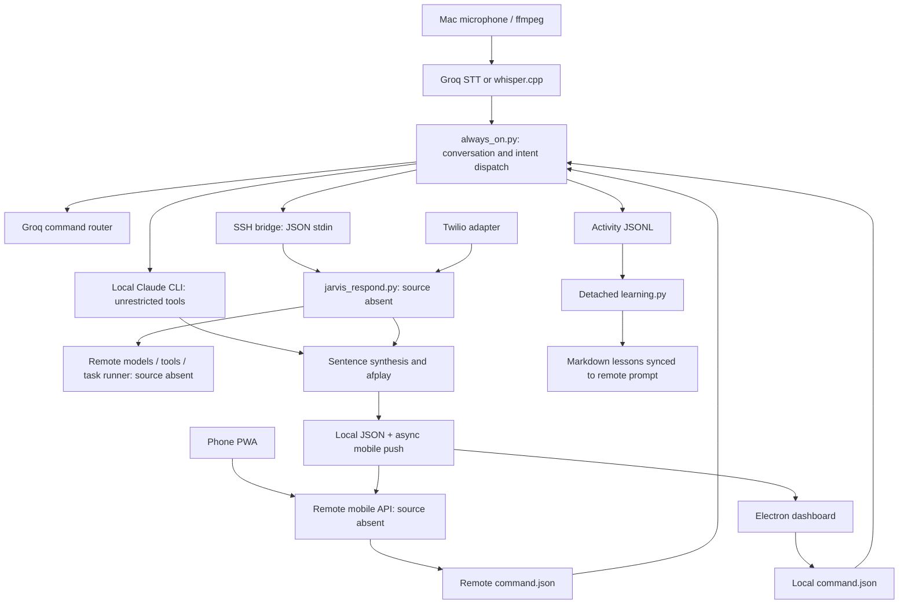

# JARVIS architecture review

Review date: October 25, 2026. Scope: the current working tree at `FRIDAY/JARVIS-local`, including uncommitted/untracked source. No application code changed. This is a local source audit with isolated reproductions, not a penetration test or certification of the deployed system.

## Verdict and score

**Current state: 4.0/10 for a reproducible, dependable open-source agent platform.** This is a capable personal-assistant prototype with real integrations, but its control plane and task lifecycle are not yet dependable enough for unattended operation. This score is an engineering assessment, not a measured industry benchmark.

| Dimension | Score | Basis |
|---|---:|---|
| Code quality and reproducibility | 4/10 | Understandable functions and useful comments; missing dependencies, absent test suite, stale run instructions, substantial untracked implementation |
| Architecture viability | 5/10 | Useful UI/transport seam and separate integrations; fragile global files, string protocols, duplicate implementations and missing authoritative lifecycle |
| Execution of OpenClaw/OpenHands-style vision | 3/10 | Voice-to-agent execution exists; auditable isolated jobs, durable recovery, validated artifacts and a self-contained distribution are not established |

Weights: 35%, 35%, 30%, respectively; weighted score 4.05, rounded to 4.0. The missing server cannot fairly receive its own score. The deployment may have capabilities this checkout cannot substantiate.

Preserve the useful work: STT fallback, real amplitude-driven TTS visualization, sentence-level synthesis, SSH stdin JSON for utterances, SSH multiplexing in Python, a narrow Electron preload bridge, and backups before file replacement. These are good ingredients. They do not provide job isolation, transactionality, or delivery guarantees.

## Discovery and six review passes

1. **Inventory and topology:** inspected the source/configuration inventory, Git tracking, requirements, package manifests, desktop bridges, and documented deployment boundaries. Found 17 Python source files and roughly 4,500 lines across Python and top-level frontend JS, plus Rust. No checked-in application test suite was found before adding the audit probes.
2. **Execution and capability trace:** traced microphone → transcription → command classification → normal/cloud/local execution → TTS, along with inbox fixing, phone and PWA entry points. Distinguished an agent CLI wrapper from an independently implemented agent runtime.
3. **State and concurrency:** traced process sessions, detached reflections, pending cloud replies, overlapping requests, fixed temporary files, and last-value command delivery.
4. **Trust and security:** traced model-controlled shell access, filenames, renderer data, bearer-token storage, biometric gating, and external webhook boundaries.
5. **Failure and API contracts:** examined timeouts, broad catches, return codes, retries, string-valued failures, memory synchronization and stale-state handling. Ran six offline probes against extracted functions/interleavings.
6. **Scale and maximum potential:** revisited the prior findings against multi-device use, process restarts, multiple simultaneous jobs, open-source installation and a durable autonomous-worker target; developed the migration sequence below.

### Actual topology



State is spread across global JSON files under `~/.jarvis-dashboard`, local activity/transcript/learning files, remote route and command files, CLI session histories, and remote task/project records. There is no local transactional store tying a request, action, artifact, result and acknowledgment together.

The checkout is **not a self-contained Claude alternative**. It delegates intelligence and much tool execution to Claude Code, and references absent `jarvis_respond.py`, `rag.py`, orchestrator, mobile API, service units and deployment infrastructure. Those implementations were not inferred from STATUS.md as though they had been audited. STATUS.md is historical context, not proof of current correctness. The separate `Downloads/jarvis-interface` workspace was not treated as the current application repository.

## Deficit blueprint

Severity describes impact in the indicated conditions. “Reproduced” means an offline probe; “source-confirmed” means a direct code path; “risk” means the actual outcome depends on deployment, scheduling, or uninspected server behavior.

### A. Execution authority and trust boundaries

**A1 — Critical impact, source-confirmed configuration: daily-driver shell access bypasses permissions.** `voice/local_claude.py:78-87` grants Bash/Read/Write/Edit and passes `--dangerously-skip-permissions`. The working directory is not a filesystem boundary. Misheard or injected instructions can reach everything available to that user, including credentials and other repositories. Remote content can reach this agent via WebFetch and files. No demonstrated exploit is claimed. Replace this with isolated per-job workers and explicit capability policy; keep personal account credentials outside workers.

**A2 — High, source-confirmed injection sinks: task data enters HTML.** `dashboard/src/main.js`, `renderTable` and `renderWorkers`, interpolates `status` and session-derived text into `innerHTML`. Status also enters an attribute. The request field escapes `<`, but other fields do not. Exploitability requires influence over returned task metadata; server validation is unknown. Use DOM creation/textContent and an enumerated status class. A same-origin script on mobile could also read the long-lived token in localStorage.

**A3 — Medium, defense gap:** Electron handlers accept IPC without validating the sending frame, command arguments are not schema-validated, no restrictive renderer CSP is supplied, and navigation/window creation is not explicitly constrained (`dashboard/electron/main.cjs`, `src/index.html`). Context isolation and disabled Node integration are positives. These missing layers amplify a renderer injection; they do not by themselves establish arbitrary code execution. Apply the [Electron security guidance](https://www.electronjs.org/docs/latest/tutorial/security).

**A4 — High if biometric mode is relied upon, reproduced/source-confirmed:** `voice/vision.py:55-73` ignores capture exit status and accepts any existing fixed-path photo. Failed capture can reuse an old owner image. `always_on.py:1008-1010` also passes an enabled gate when no face is enrolled. There is no liveness check or continuing authentication. Biometric mode is currently intentionally off by default; do not describe it as an active security guarantee. Fail closed when explicitly enabled; capture to unique private files and verify success/freshness. Prefer OS-backed authorization for privileged operations.

**A5 — Medium, source-confirmed exposure:** `/tmp/jarvis_camera_capture.jpg` and `/tmp/jarvis_clap_utterance.wav` are predictable and shared across instances. Camera images are retained. Symlink attacks depend on filesystem access, but collisions and unintended retention need no adversary. Use private temporary directories, exclusive file creation and cleanup.

**A6 — Medium, conditional command injection:** Electron and Rust interpolate configured `remote_results_path` into a remote shell `tail` command; Python similarly embeds configuration into remote Python/shell strings. Local `execFile` prevents local shell interpretation, not remote shell interpretation. Only configuration-controlled input is established here. Validate configuration and use a fixed remote RPC entry point with stdin payloads.

**A7 — Medium, dormant bridge:** `os-bridge/os_control.py:49-53` embeds app names directly in AppleScript. SAFE_MODE currently prevents execution. Quote/validate names before enabling it; the safe-mode policy does not cover the separate unrestricted Claude path.

### B. Task lifecycle, concurrency and cancellation

**B1 — High, source-confirmed reply loss:** `always_on.py:1103-1145,1322-1330` stores pending cloud results in a function-local list. A no-follow-up timeout returns even while workers run. Later completion has no delivery owner. Persist jobs independently of conversations; deliver completion through an acknowledged event stream.

**B2 — High, architectural risk:** repeated cloud turns start daemon threads using the same CLI session ID without local serialization or admission limits. Server locking is uninspected. Concurrent resume calls can reject, race or interleave conversation state. Serialize turns per session, bound global workers, and separate independent job sessions.

**B3 — High, reproduced unsafe retry:** `local_claude.py:94-103` retries *every* nonzero resumed run as a new session. An action can partially execute and then fail, making reissue unsafe. Detect only the specific nonexistent-session condition before execution, track known session creation, and attach request/action idempotency identifiers.

**B4 — High reliability gap:** interruption stops speech, not local agent subprocesses or synchronous SSH work. During blocked agent calls the main loop cannot act on an interrupt. Local subprocess timeouts are uncaught by the caller and do not provide process-tree cancellation. Build a cancellation token propagated through transport, inference, tools and child process groups; report whether execution actually stopped.

**B5 — Medium, source-confirmed lossy/replayed commands:** Electron writes one `command.json`; watchers remember only the last ID in process memory and ignore command age. Multiple writes between polls overwrite each other. Restart consumes the last saved command again. Non-atomic writes can also yield transient invalid JSON. Use a queue with durable IDs, expiration and acknowledgment, not a last-value register.

**B6 — Medium, reproduced interleaving:** `voice_state.py:23-26` and `routing_state.py:25-27` use a fixed `.json.tmp` name. Atomic rename protects readers from partial JSON, but overlapping writers can publish the other writer's payload or raise FileNotFoundError. One owning writer or uniquely named temporary files plus ordering is required; uniqueness alone does not solve stale updates.

**B7 — Medium, scheduling risk:** barge-in monitor reads the shared mic pipe and is joined for only one second; a blocked read can outlive that join and compete with recording. `_read_exact` has no deadline, so wall-clock recording limits do not protect a stalled pipe. Give one capture task exclusive pipe ownership and distribute bounded audio frames to consumers.

**B8 — Medium, source-confirmed resource leak:** `jarvis_voice.py:speak` pre-synthesizes the next sentence. On interruption a pending/completed future can leave its delete=False WAV behind; shutdown(wait=False) does not cancel running synthesis. Track and clean every owned future/artifact and terminate synthesis when appropriate.

### C. File/artifact integrity and provider contracts

**C1 — High, reproduced data corruption:** `file_bridge.py:99-117` calls `ask_jarvis` with background work allowed and without requiring the reasoning route. It downloads a predictable output path regardless of generation success. A failed/timed-out/new background job can therefore replace input with a prior output. Use unique job directories and accept only an explicitly successful result manifest tied to the input digest.

**C2 — High, source-confirmed conflict gaps:** inbox fixing follows file symlinks, uses basename-only remote destinations, second-resolution backup names and a fixed download name. No compare-before-replace detects user edits during processing; file mode is not explicitly preserved on replacement. Restrict resolved paths, reject unexpected types/symlinks, use unique artifacts, preserve metadata intentionally, and compare the current input hash before apply.

**C3 — Medium, reproduced/systemic contract flaw:** provider failures are returned as plausible prose. Consumers cannot reliably distinguish answer, error, accepted job or timeout. `learning.py` rejects only a few failure prefixes and can persist other transport failures as lessons. Return typed envelopes (`ok`, request/job IDs, error code, retryability, payload); generate spoken error messages only in presentation code.

**C4 — Medium, source-confirmed false success:** `jarvis_client.py:193-201` reports knowledge reindex success without checking returncode. SCP sync uploads current files but does not remove deleted remote documents; incomplete multi-file sync can be indexed. Build a content-addressed corpus manifest, upload to a versioned directory and activate only a verified successful index.

**C5 — Medium, reproduced router parsing:** `command_router.py:87-90` uses substring matching in priority order. An invalid answer such as `NONE: do not select LOCAL or CLOUD` becomes cloud. Accept only exact enum values or a validated schema; never treat model classification as authorization.

**C6 — Medium, API resilience gap:** HTTP calls generally use individual timeouts but no common deadline, bounded retry/backoff policy, Retry-After handling, circuit breaker or durable retry outbox. Broad catches erase provider diagnostics. Retries must distinguish safe reads from side-effecting work; do not blanket-retry tool actions.

### D. Memory and distributed state

**D1 — Medium, reproduced retention defect:** `_recent_digest` (`learning.py:181-199`) keeps only eight recent sections and the last 4,000 characters, contrary to the comment claiming preservation of all corrections. Earlier explicit rules disappear; truncation can split a rule. Store corrections as structured records with provenance, priority, conflict handling and separate token budgets.

**D2 — High trust risk:** session reflection asks a tool-capable reasoning agent to process raw transcript text, then automatically injects model-generated imperatives into future prompts. No verified fact/rule schema or trust distinction separates transcript content from standing policy. This creates a durable prompt-poisoning path; exploit success was not tested. Use a tool-free reflection model, structured candidates and provenance; user preferences must never silently become security policy.

**D3 — Medium, source-confirmed attribution/race gap:** reflection selects every activity entry newer than a timestamp, with no end bound or session ID. Detached reflections can absorb later conversations, overlap on append/preamble writes, and overwrite remote lessons out of order. Normal completion plus shutdown can reflect the same interval again. Capture a closed immutable session range and process an idempotent reflection job transactionally.

**D4 — Medium, source-confirmed weak sync:** local transcript sync is a daemon thread whose Boolean result is ignored. A quick tier switch can occur before sync; process exit loses it. Local Claude does not ingest the remote transcript or learned lessons through this code, so shared memory is asymmetric. Use one canonical conversation store and durable outbox; construct context deliberately for every provider.

**D5 — Medium, source-confirmed state fan-out:** every speech amplitude write starts a new HTTP thread (`mobile_sync.push_async`), roughly 16.7 submissions/sec at 60ms updates. Five-second slow requests imply roughly 83 concurrent in-flight threads in steady state, with more possible under scheduling pressure. Sends can arrive out of order, and cached missing/old tokens are never reloaded. Use a bounded latest-value worker, sequence numbers, connection reuse and credential refresh; keep animation-rate amplitude local and downsample remote telemetry.

**D6 — Medium, misleading liveness:** Electron resets non-idle voice state after 20 seconds even though local calls allow 180 seconds and remote calls 90 seconds. Legitimate thinking appears idle. Route selection compares timestamps from two machines without clock-skew handling; network failure can falsely restore an old local route. Use heartbeats plus request IDs and stream sequence numbers, with an explicit disconnected/stale state.

### E. UI, phone, distribution and scale

**E1 — Medium, source-confirmed polling amplification:** `main.js` starts refresh every five seconds, routing every three seconds and voice polling every 150ms without single-flight guards. Refresh itself makes sequential remote calls. Slow requests overlap and older responses can repaint newer state. On mobile, voice polling alone is about 400 API reads/minute per open client. Use one snapshot plus SSE/events, cancellation and bounded polling fallback; pause hidden clients.

**E2 — Medium, source-confirmed platform regression:** documented Tauri commands load `main.js`, which unconditionally destructures `window.__JARVIS_BRIDGE__`; Tauri supplies `__TAURI__`, not that bridge. No Tauri adapter was found. The Rust handler set also lacks dashboard commands. Choose Electron as the supported runtime or restore an explicit tested Tauri adapter and contract tests.

**E3 — High for a slow phone turn, integration risk:** `phone/twilio_server.py:110` runs `jr.respond` inline with no handler deadline. Twilio imposes a [15-second hard limit for call-related HTTP requests](https://www.twilio.com/docs/usage/webhooks/webhooks-connection-overrides). Slow reasoning can exceed that budget, with side effects still running. Return TwiML promptly, persist a job and use bounded status redirects/call updates. De-duplicate webhook processing and use a production server when activated. Existing signature and owner-number checks are useful; they are not evidence that the missing backend is secure.

**E4 — Medium, source-confirmed TwiML construction bug:** `phone/make_call.py:25-26` substitutes quotes but does not XML-escape message text. `&`, `<`, or closing tags can break/change TwiML. Use VoiceResponse/Say serialization. The configured no-message outbound callback also needs a live test because owner filtering compares `From` to the owner while outbound calls originate from the Twilio number. CallSid is passed directly as a model session ID: compatibility with any UUID-only CLI contract must be verified in the absent backend.

**E5 — Medium, reproducibility blocker:** voice requirements omit directly imported `requests`, `face_recognition`, `numpy`, `cv2`/OpenCV and MediaPipe. Camera modules are imported even when camera features are disabled. Pin/lock dependencies, define optional extras, lazy-load disabled features, and document system/model requirements with checksums. Import-time microphone discovery and model downloads further obstruct clean tests and predictable startup.

**E6 — High delivery gap:** core current modules, Electron/PWA code and knowledge/persona directories are untracked in Git. A clean clone cannot reproduce the reviewed working tree. The local repo has no LICENSE file, top-level installation guide or CI workflow in the inspected inventory. Audit dependency/model licenses separately; this review does not establish legal permission to redistribute them. Do not blindly commit private knowledge or credentials; prepare a sanitized distributable source manifest.

**E7 — Medium, deployment coupling:** host addresses, home paths, remote directories and model identity strings are duplicated across Python, Electron, Rust and mobile JS. Configuring one endpoint does not configure all transports. Local identity text contradicts shared-memory claims; lessons still claim mandatory camera verification despite the current intentional disablement. Centralize versioned configuration and generate capability descriptions from actual enabled adapters.

**E8 — Medium, operational gap:** no inspected CI/test suite, migration system, request-level trace IDs, durable dead-letter handling, restoration drill, or measurable completion/latency evaluation. The dashboard tracks separate orchestrator service and conversational task sources, so one service status is not whole-system health. Logs grow without rotation/retention and contain personal conversations. Add structured telemetry and explicit per-component readiness/liveness.

**E9 — Lower priority:** GPU-heavy rendering has no demonstrated adaptive mobile quality policy or WebGL-failure fallback; frontend build emits a >500KB chunk warning. Improve only after correctness work. PWA fetch has no explicit deadline and blindly parses JSON even on error responses; service-worker cache writes lack lifecycle extension and offline fallback may miss entirely. Provide bounded requests and explicit offline/authentication states.

## Potential mapping

There is no defensible finite “absolute maximum” inferred from source alone. The useful ceiling is the set of systems this foundation can credibly evolve into, with the required additions stated explicitly.

| Capability | Existing leverage | Required bridge |
|---|---|---|
| Personal voice coding assistant | STT/TTS, CLI tooling, local/cloud routing | Reliable turn handling, cancellation, typed results |
| Cross-device command center | Desktop/PWA transport seam, remote callbacks | Device-scoped credentials, event stream, canonical state |
| Long-running project builder | CLI agent delegation and background-task integration | Durable job supervisor, isolated workspace, artifacts, progress and recovery |
| Repository issue-to-PR worker | Read/write/shell access and task UI | Git worktrees, test/review gates, scoped Git credentials and PR adapter |
| Private document/knowledge assistant | Knowledge/persona upload seams | Versioned index, provenance, access policy and retrieval evaluation |
| Memory-aware personal automation | Activity history and reflection hooks | Structured memory, retrieval, provenance, retention and conflict resolution |
| Small shared/team agent service | Remote compute boundary | Authentication/authorization, quotas, tenant isolation, queues and storage redesign |
| Provider-independent open-source platform | Existing routing abstraction | Provider/tool interfaces and a bundled independently runnable core |

This code does not establish model training, self-improving weights, general autonomous correctness, secure multi-tenancy, or a complete browser/computer-use agent. Reflection changes prompt context; it does not train a model. Local CLI execution still depends on an external model/provider and is not evidence of offline intelligence. Team scale requires major new control-plane work, rather than tuning thread counts.

## Optimization roadmap

### Phase 0 — Stop data loss and unsafe reissue

1. Fix C1/C2 first: unique job-scoped paths, typed success manifest, input digest, complete generation before download and compare-before-apply. Preserve backups and metadata.
2. Remove permission bypass from everyday execution. Introduce an explicitly scoped execution profile; isolate untrusted coding jobs before restoring unattended shell authority.
3. Make local resume fallback specific and non-repeating; catch timeout/launch failures and distinguish failed, cancelled and uncertain completion.
4. Replace task HTML interpolation; enforce IPC sender/argument validation and CSP. Keep camera opt-in, but make its enabled gate fail closed.
5. Add targeted regression tests from the six probes. Convert their assertions to desired behavior when fixed.

Exit gate: failed generation cannot change a local input; invalid router output cannot switch modes; retries cannot silently reissue a possibly executed action.

### Phase 1 — Establish one authoritative control plane

Use a modular Python service initially; a microservice split would add failure modes before the state model is sound. Use SQLite with transactional updates for a single-user deployment; adopt Postgres when several hosts must write concurrently. Do not operate a shared SQLite file over a network filesystem.

Suggested structure:

```
core/contracts.py       # validated request/result/event schemas
core/sessions.py        # ordered turns and context construction
core/jobs.py            # durable state transitions, leases, idempotency
core/policy.py          # tool and resource authorization
providers/              # model adapters, deadlines, typed failures
workers/                # isolated CLI/tool execution, process supervision
memory/                 # facts, preferences, corrections, provenance
transports/             # local socket, authenticated HTTP, Twilio
clients/voice/           # exclusive capture owner, VAD, STT/TTS
clients/dashboard/       # presentation through a stable client API
```

Use IDs for principal/device/session/turn/job/action/artifact. Job states: queued → running → succeeded/failed; cancellation goes through cancel_requested → cancelled only after worker acknowledgment. A lease/heartbeat detects vanished workers. Store accepted requests and outgoing events in the same transaction, then deliver via a retryable outbox. Resume delivery after reconnect. Serialize conversation mutations per session while independent jobs use separate contexts.

Exit gate: restart at every lifecycle boundary preserves accepted work and completion; duplicate delivery produces one logical action/artifact.

### Phase 2 — Rebuild execution and voice around bounded ownership

One audio task owns ffmpeg reads and feeds bounded queues. Conversation logic becomes an explicit state machine (idle/listening/transcribing/dispatching/speaking/recovering); a separate supervisor owns jobs beyond any individual wake. Cancellation propagates to provider requests and process groups. Preserve sentence pipelining, but track every temporary artifact/future. Stream progress/results through SSE or WebSocket; local Unix sockets can replace command files.

Use one model gateway with request budgets, validated outputs, reusable clients, safe retry policy and rate-limit handling. Use a tool-free model for classification/reflection. Put coding workers in containers or stronger isolated environments with job-specific directories, restricted network egress and scoped credentials. A cwd or prompt is not isolation.

Exit gate: a long job completes and reports after the user goes silent; stop reports whether execution stopped; slow mobile networking cannot create unbounded threads.

### Phase 3 — Unify memory and artifact truth

Store raw immutable events separately from derived memories. Give each memory source, scope, confidence, creation/expiry and supersession metadata. Treat user corrections, inferred observations and security policy as different records. Retrieve within a token budget; pin intentional preferences explicitly. All model providers consume context from the same builder. Project completion records must derive from actual job/artifact/test status, not a summary's claim.

Exit gate: changing provider preserves relevant context; concurrent reflections are idempotent; old high-priority corrections remain retrievable; failed requests do not become lessons.

### Phase 4 — Ship a reproducible product and evaluate it

Bring the remote core and deployment configuration into version control after sanitization. Choose one desktop runtime, provide versioned example configuration, optional voice/camera extras, model acquisition checksums, migrations, service startup and backup/restore instructions. Add a project license after deciding distribution terms. CI should cover clean install/build, core tests, contract tests and fault injection.

Evaluate scripted end-to-end tasks: accepted job recovery, double submit, provider 429/500/malformed output, network disconnect, microphone stall, disk full, stale artifact, concurrent turns, hostile document instructions, cancelled subprocess trees, token rotation and device reconnect. Measure time to acknowledgment/first answer, verified completion rate, duplicate-action rate, recovery success and cost per completed task. Establish baselines before setting performance claims.

Exit gate: a new contributor can clone, configure and run the supported system; an isolated coding task produces a reviewable diff plus actual verification evidence.

## Verification and remaining uncertainty

- `npm run build`: passed with installed dependencies; Vite warned about a >500KB output chunk. This proves frontend compilation, not desktop/PWA operation.
- Python AST parsing: all 17 inspected Python source files passed. This does not validate imports or runtime dependencies.
- `python3 audit/reproduce.py`: six probes passed, confirming current failure behavior for stale camera image, correction eviction, broad action reissue, stale artifact overwrite, router substring parsing and fixed-temp writer interleaving. The last probe demonstrates the deterministic file-operation interleaving rather than a stress test of live threads.
- No live model calls, SSH, phone calls, camera/microphone access, server modifications or agent execution were used. No dependency CVE inventory or production load test was performed; package age alone was not reported as a verified CVE.
- Server-side authorization, mobile token scopes, task locking, command consumption, RAG correctness, credential management, worker sandboxing and recovery remain unverified because their source is absent. Inspect those components before treating this as an end-to-end audit.

The highest-return investment is a durable job lifecycle with bounded, isolated execution. Keep the UI and voice integrations; make them clients of that lifecycle.
